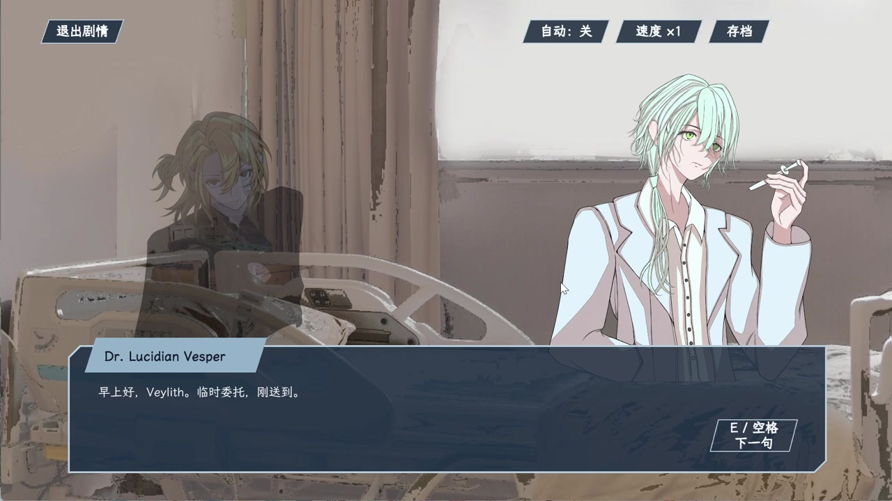

# 入梦师 Dreamweaver

  

  
  
  
  

《入梦师》是一款使用 Unity 制作的 2D 叙事动作游戏 Demo，围绕梦境探索、分支剧情、角色动作与多槽位存档展开。

> 这是个人学习与求职展示项目。开发过程中使用 ChatGPT 与 Codex 辅助架构讨论、样板代码生成和代码审查；我负责需求拆分、功能集成、运行验证、问题定位与迭代修改。项目仍在持续整理，不代表商业成品。

## 试玩与演示

| 内容 | 入口 |
| --- | --- |
| 浏览器在线试玩 | [打开 WebGL 试玩版](https://wanjunyi310.github.io/dreamweaver-showcase/) |
| 游戏演示视频 | [前往 v0.1.0 Release 观看](../../releases/tag/v0.1.0) |
| Windows 试玩包 | [下载 v0.1.0 试玩版](../../releases/tag/v0.1.0)，完整解压后双击 `入梦师.exe` |
| 功能自测记录 | [查看测试清单](docs/TEST_CHECKLIST.md) |

WebGL 版建议使用桌面端 Chrome 或 Edge 打开，首次加载需要下载约 31 MB 资源。Windows 试玩包支持 Windows 10/11 64 位系统，试玩包和演示视频通过 GitHub Releases 单独提供。

## 我负责的工作

- 将角色移动、跳跃、墙面动作、攻击、交互与角色切换整合为可运行的玩法流程。
- 搭建数据驱动的对话、选项、条件分支、标记、存档点与等待节点。
- 串联剧情中心、关卡选择与玩法场景，维护解锁、完成状态和剧情回看数据。
- 完成 JSON 多槽位存档、临时文件写入、覆盖前备份、读取失败回退和格式版本迁移。
- 通过人工测试复现并修复无限跳跃、落地状态误判等问题，整理持续回归清单。

## 技术信息

- Unity `2022.3.62f1 LTS`
- C# / Unity Input System / UGUI / 2D Physics
- ScriptableObject 数据配置
- JSON 多槽位存档
- WebGL / Windows Demo

## 已实现功能

### 角色与操作

- 移动、跳跃、跳跃预输入与土狼时间
- 二段跳、墙面滑行和蹬墙跳
- 攻击、角色能力、交互与角色切换
- 键盘与手柄输入配置、按键冲突检查

### 剧情与关卡

- 数据驱动的对话、选项、跳转、条件分支、标记、存档点与等待节点
- 剧情中心、关卡选择和玩法场景之间的状态传递
- 前置剧情、关卡解锁、完成状态和剧情回看

### 存档与容错

- JSON 多槽位存档
- 临时文件写入与覆盖前备份
- 当前存档读取失败时回退备份
- 格式版本记录与新增字段迁移

## 问题定位与验证

| 问题 | 定位与处理 | 验证结果 |
| --- | --- | --- |
| 角色偶发无限跳跃 | 检查空中次数与落地重置条件，限制可用空中跳跃次数 | 修复后复测通过 |
| 落地状态误判 | 过滤角色自身碰撞体，避免自身碰撞被识别为地面 | 修复后复测通过 |
| 墙面状态切换不连续 | 检查贴墙、离墙和蹬墙状态转换条件 | 完成人工流程验证 |
| 剧情分支跳转异常风险 | 按选项、标记和条件分别验证目标节点 | 完成人工流程验证 |
| 存档读取异常 | 保留备份回退路径与安全返回逻辑 | 已实现，继续补充异常样本 |

更详细的范围见 [《入梦师》Demo 自测清单](docs/TEST_CHECKLIST.md)。

## 默认操作

| 操作 | 按键 |
| --- | --- |
| 移动 | `WASD` |
| 跳跃 / 墙跳 | `Space` |
| 普通攻击 | `J` |
| 角色能力 | `K` |
| 互动 / 对话 | `E` |
| 切换角色 | `Tab` |
| 地图 | `M` |
| 暂停 / 返回 | `Esc` |

## 公开范围说明

本仓库是面向招聘方的公开作品展示页，包含项目说明、演示素材、试玩包与测试记录。完整 Unity 工程和源代码保存在私有仓库中，不在此公开，以降低原创内容被直接复制以及第三方素材被误分发的风险。

如在面试或技术交流中需要核验实现细节，可展示局部代码、工程结构和运行过程。

## 当前限制

- 当前为学习型 Demo，部分界面、美术和关卡仍使用占位内容。
- 试玩包以人工功能验证为主，尚未建立完整的自动化测试套件。
- 第三方素材继续适用各自许可，不随本展示仓库授予任何额外权利。

## 权利声明

本仓库仅用于个人学习记录与求职作品展示。除另有说明的第三方内容外，项目原创内容版权归作者所有；未经许可，不授予复制、再发布、改编或商业使用权。详见 [NOTICE](NOTICE.md)。
